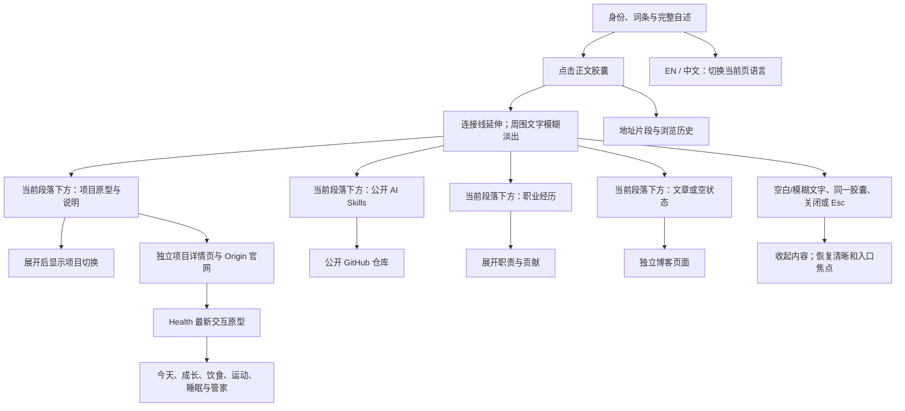
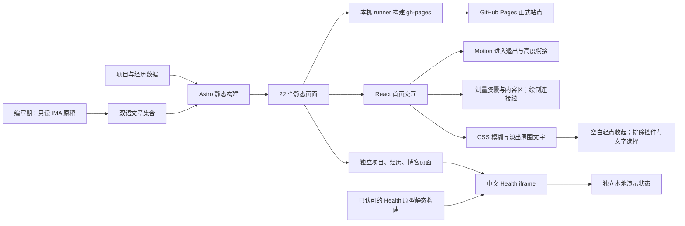

# 个人官网如何工作

## 当前产品

这是 Joe Cai 的双语静态个人网站。首页直接展示头像、姓名、社交图标、Product Builder 词条和四段完整自述。头像来自 Joe 的 GitHub 公开资料。Product Builder 用词典形式呈现，包含 noun、音标和个人释义：从自己真正想改变的现状出发，想象一种更好的可能，并把它做成对他人也有价值的产品。

所有页面均没有永久顶栏或版权页脚。首页只显示 Joe Cai，不显示中文名；姓名右侧提供浅色和深色按钮，邮件图标保留联系入口。首页与独立页都在明暗切换旁显示 EN 或中文入口；独立页的返回入口保留在左侧。切换打开当前页面的另一语言版本，中英文地址均可直接访问。

自述中的 Origin AI、Origin Health、Craft、Prose、AI skills、职业经历和写作是带图标的胶囊入口。初始不显示相关内容区。点击胶囊后，内容在该段文字下方展开；连接线从胶囊延伸到内容区，周围文字模糊、淡出。胶囊和展开内容保持清晰，访客仍可切换入口。

“聚焦”类似阅读时把其他内容放到景深之外：页面仍在原处，当前作品更清晰。它不是弹窗，不锁定页面滚动或键盘焦点。再次点击同一胶囊、点击页面空白或模糊文字、点击关闭按钮或按 Esc 可收起；文字恢复清晰，焦点回到原入口。卡片、链接、主题按钮和经历折叠区内的点击不会误收起，已有文字选择、拖动与滚动也会被排除。

项目、经历和博客保留独立页面。四个项目另有中英文详情地址，例如 `/projects/craft/` 与 `/en/projects/craft/`。项目卡片与详情都不显示开发阶段或“设计原型”标签。项目列表没有解释性副标题。详情先用一两句话说明产品为谁解决什么问题，再展示图片或交互体验；不显示技术标签、“项目介绍”标题或原型图注。Health 详情只保留官网链接与内嵌体验，不提供单独的全屏入口。Origin AI 与 Origin Health 的卡片和详情页提供 origin.town 官网链接；没有设置外链的项目不会生成外链。旧的 `origin-im` 地址保留，显示名称为 Origin AI。

## 内容与架构

- Astro 在构建时生成静态页面。首页通过 React 和 Motion 管理展开、退出、连接线和高度衔接，不在访问时调用 AI。
- `src/data/` 保存实际项目、经历、公开 Skills 与双语文案。项目数据包含原型预览图路径。
- Origin AI、Craft 和 Prose 的介绍从作者为什么做出发，说明谁会用、具体做什么；标题下的短句只说明产品用途。首页卡片、项目列表、项目详情与无脚本摘要共用这份双语数据。文案描述创作动机和产品目标，不声称所有能力已上线。
- AI Skills 展示 writing-doc、how-it-works、product-prototype、google-ads 四个公开项目，每项有独立的用途、方法预览与 GitHub 链接。Google Ads 标为实验项目，不声称广告配置、支付或合规已获验证。
- 用户授权的两个 GitHub 仓库已在线重命名为 product-prototype-skill 与 google-ads-skill。仓库 ID、提交与公开状态保持，旧地址仍解析到新名称。实际技能名分别为 product-prototype 和 google-ads-setup。
- 职业经历以 Shadoweave 为当前工作（2026.07—至今），Anyway 为 2025.12—2026.07。职责与边界根据用户指定的简历对话核对。50+ 家指需求沟通与试用/POC 探索，不是正式接入或付费客户。
- 首页组件读取实际项目和经历数据。博客从当前语言集合读取最多三篇已发布文章。
- 博客目前有《愿景》《好的写作，是好的思考》《环境的重要性》三篇中文随笔及对应英文版本；首页展示三篇，RSS 包含三篇中文文章。展示日期按作者要求设置：《好的写作，是好的思考》2026-10-29、《环境的重要性》2026-09-18、《愿景》2026-08-04。列表按日期从新到旧排列；文章页仅显示日期，不显示标签。展示日期不代表本轮已在当日上线。
- 《好的写作，是好的思考》围绕作者明确的主张展开：写作暴露思考的缺口，帮助团队讨论问题与取舍；交付的产品凝聚这些判断，并接受真实使用的检验。中英文正文对应，原有文章地址保留。
- 文章以 IMA 中用户自己的《愿景》口述稿、《Great PM》复盘、《Creating a Motivated Environment before Anything Happens》未完稿和《网站》自述为依据，经子 agent 撰写与主线复核。参考 Jason Fried 文章的高层结构，不复用其措辞与经历。
- 项目图像来自各项目已有原型。Health 封面与可交互内容来自 Origin_Health 10 月 29 日认可的 health-home React 原型，不使用旧官网的静态餐食截图。
- Health 详情通过 iframe 嵌入本地静态 bundle。它保留手机内交互，隐藏外部评审控制台；演示状态使用独立浏览器 localStorage，不连接原项目用户数据。照片分析等演示结果不能当作真实 AI 服务、健康判断或线上渠道验收的证据。当前原型为中文源版本，英文详情同样嵌入这一版本。
- 服务器 HTML 保留完整自述、内容摘要和直接链接。禁用 JavaScript 时可阅读静态内容；聚焦展开和主题按钮需要 JavaScript。仅禁用 React 脚本但仍运行页面引导脚本的故障状态没有单独处理。
- IMA skill 1.1.10 已安装在本机，本轮只用于写作准备中的只读查询。凭据保存在仓库外的本机配置，不进入网页、构建产物或文章。访问者不会连接 IMA。
- 网站没有账户、后台 Agent 或数据库。

## 发布方式

源码保存到 GitHub 仓库 `joevilcai666/joevilcai666.github.io` 的 `main` 分支。现有发布流程在注册到此仓库的本机 runner 执行依赖安装与静态构建，发布 `dist/` 到 `gh-pages`；GitHub Pages 从该分支提供网站。发布结论以准确提交的本地检查及正式网址实际内容为准，不以 GitHub Actions 状态作为验收门槛。

本机的研究、截图、会话日志与早期临时原型不包含在本次源码提交中。下方 `docs/research/` 与 `docs/verification/` 路径是本机证据位置。

## 样式、主题与交互

桌面容器上限 768px，内边距 24px，内容宽度 720px。首页距离顶部 64px，手机为 32px。头像在桌面为 160px、常规手机为 104px、320px 窄屏为 80px。词条使用衬线字体，自述与界面使用系统无衬线字体。桌面释义为 14px，并使用完整内容宽度，以一行呈现中文；手机释义为 15px，保留自然换行。

首页提供浅色和深色两个按钮。访客尚未手动选择时跟随系统，两个按钮显示当前实际颜色。独立内容页同样只提供浅色和深色两个按钮。语言入口与它们并排，窄屏首页必要时自动换行，避免挤出页面。主题共享并保存在浏览器本地，刷新后仍生效；页面引导脚本提前应用主题，减少闪烁。

URL 片段记录当前内容区，可以直接分享；浏览器前进后退会恢复选择。项目切换入口仅在作品区打开后显示。连续点击以最后一次选择为准，跨段落选择会把内容移到对应段落下方。

内容区根据实际高度展开，连接线使用 SVG 和 clip-path 呈现。正常动效下，指针触发单阶段约 200–240ms；展开后，必要时轻滚动，让来源胶囊与作品进入视野。周围文字 blur 2–2.5px，并降低透明度。关闭时连接线收回，文字恢复清晰。

键盘触发立即完成。减少动态效果时去掉内容位移、连接线绘制和高度动画，保留约 120ms 内容淡入淡出；模糊状态直接切换。关闭后焦点回到原胶囊，并在内容收起后让该入口进入视野。职业经历使用原生折叠控件。

`W`、`P`、`B` 分别跳转经历、项目和博客页。`Esc` 在首页关闭内容区，从独立页面返回首页。

## 验证与限制

| 层次 | 当前证据 |
| --- | --- |
| 代码 | 全站移除永久顶栏，首页不显示中文名；详情精简为产品出发点和体验；项目卡片不显示阶段或原型标签，Health 无全屏入口；写作文章论点、双语正文与摘要一致。四项 Skills、文章日期与 Health 交互原型已接入。 |
| 本地构建 | 发布提交 `e0e0d096a2a5afd57a9988adc212d964a1d09420` 在独立源码目录执行 `npm ci --no-audit --no-fund`、`npm test` 与 `npx tsc --noEmit`，生成 22 个页面，31 项检查通过，包含首页双向语言切换。 |
| 浏览器运行 | 已检查详情无顶栏/标签/图注、说明位置、博客顺序、四项 Skills。320×800 的文章、Skills 与 Health 详情没有横向溢出。 |
| 本地交互 | 首页的空白收起、选择保护和主题检查已通过。Health 源 bundle 已检查今天、成长、拍照入口、明确的示例分析与管家。实际详情页 iframe 也通过键盘切换与临时 Chrome 的真实点击检查。 |
| 动态效果 | 当前内置浏览器启用减少动态效果；已检查内容聚焦、关闭和展开后定位。另用 REA 临时 Chrome 的正常动效环境完成 Health、卡片内点击保持、模糊文字收起、Skills 与写作的 13 个场景步骤，控制台没有应用错误。截图不证明真实手机触摸体验或逐帧性能。 |
| 线上运行 | https://joevilcai666.github.io/ 已发布语言入口修复。77 个公开页面与资源返回 200，并与 runner 产物逐文件匹配；首页与独立页顶部均有对应语言链接。在线浏览器预览超时，不计为线上点击复查通过。 |
| 用户验收 | 用户已认可当前设计与项目文案，并授权推送远程及更新正式网站。 |

网站功能发布提交为 `e0e0d096a2a5afd57a9988adc212d964a1d09420`，本机 runner 实际检出的也是该提交，生成的 `gh-pages` 提交为 `7bfa3f179ff66a07ae79102673a3742460428687`。独立源码检查环境为 macOS arm64、Node v24.18.0、npm 11.16.0。独立构建与 runner 的静态文件一致；仅两个首页的 Astro 自动生成实例标识不同，去掉该标识后内容一致。

本机 runner 的仓库范围已核实为 `joevilcai666/joevilcai666.github.io`。结论来自准确提交的本地检查、runner 实际产物和公开文件校验，不依赖 GitHub Actions 状态或计费信息。详细发布记录见 [语言入口发布核对](docs/releases/2026-10-29-language.md)。

此前内容截图在 `docs/verification/content-20261029/`，布局与动效场景在 `docs/verification/portfolio-20261029/`；Health 原型独立检查在 `docs/verification/origin-health-embed-20261029/`，本轮详情页检查在 `docs/verification/details-20261029/`。本轮文章与项目精简的截图在 `docs/verification/copy-20261029/`。文章和经历的来源概括在 `docs/research/`，不保存 IMA 原文或凭据。未做真实手机触摸或多浏览器验收。

最后更新时间：2026-10-29（Asia/Shanghai；统一顶部中英文入口）
