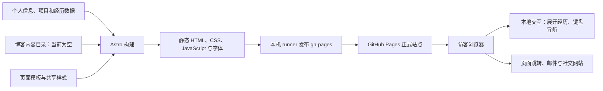
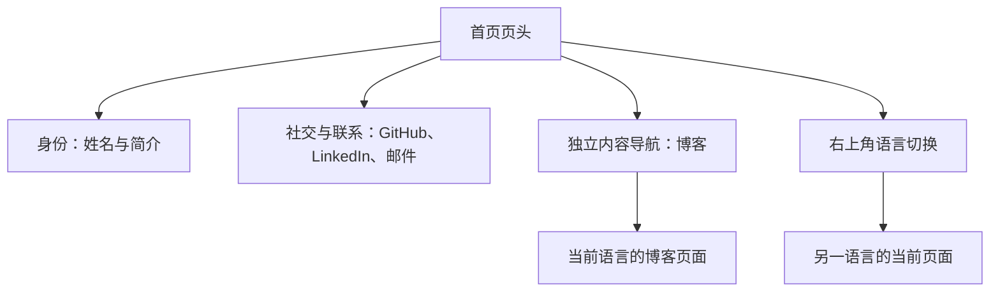
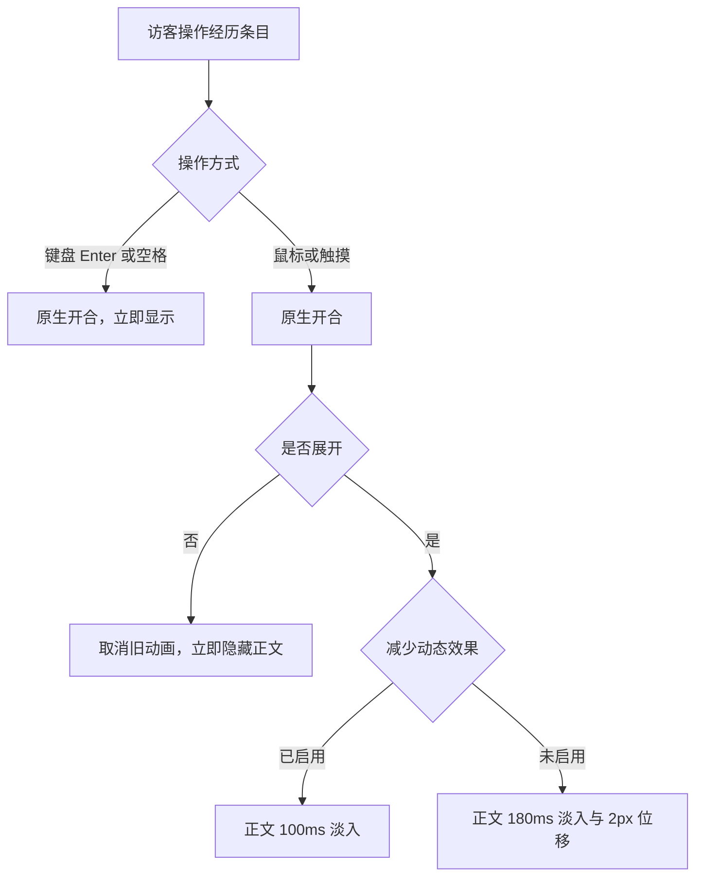
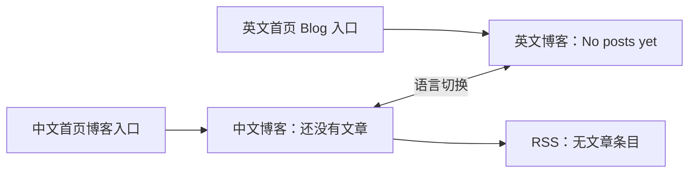

# 个人官网如何工作

## 当前产品

这是一个静态个人网站。首页依次展示姓名与联系方式、关于、项目、职业经历。页头分为三类功能：姓名下方的 GitHub、LinkedIn 和邮件组成社交与联系组；独立的“博客 / Blog →”文字导航位于下方；语言切换位于页头右上角。项目保留桌面双列、窄屏单列的排列。职业经历在首页折叠展示，点击后展开详情。项目、经历和博客也各有独立页面。

中文页面位于根路径，英文页面位于 `/en/`。首页、项目、经历和博客页均有中英文版本。当前没有博客文章，两个内容目录只保留目录占位文件。中文博客显示“还没有文章。”，英文博客显示“No posts yet.”。RSS 保留订阅地址，但没有文章条目。旧文章详情页不再生成。

“静态网站”类似预先印好的书：构建时把内容排成页面，访客打开时直接阅读。本站不在访问时调用 AI，也没有后台 Agent、账户或数据库。

## 页面与样式

- `src/data/` 保存个人信息、项目、经历及中英文文案。
- `src/components/bodies/` 定义各类页面的内容排列。
- `src/layouts/BaseLayout.astro` 提供页头、页脚、SEO 元信息和浏览器交互。
- `src/components/LanguageSwitch.astro` 统一语言切换按钮，`src/layouts/BlogPostLayout.astro` 统一中英文文章版式。
- `src/styles/global.css` 统一颜色、字重、间距、边框与响应式样式。
- `src/content/blog/` 保存中文文章，`src/content/blog-en/` 保存同名英文文章，构建时忽略标记为草稿的文章。

正文内容宽度上限为 42rem。背景为白色，标题、正文、辅助信息分别使用不同深浅的灰色。日期保留等宽字体。项目说明和副标题使用无衬线字体。项目卡片使用 12px 圆角、细边框与很轻的静态阴影。

窄屏英文经历的日期位于职位与公司下方，为较长的英文名称留出空间。中文经历的日期保持右对齐。

目前三个项目没有设置外部链接，因此卡片与标题只是信息展示，不提供点击动作，也没有悬停旋转或抬升。未来为项目添加链接时，模板会显示标题链接与链接行。

## 交互与动效

页头的三个联系按钮呈现 36px 外观，并扩展至约 44px 点击范围。按下时缩小至 0.97 倍，过渡为 140ms。博客入口使用带箭头的文字链接，语言切换使用独立的文字控件，两者均保留至少 44px 高的点击范围，不使用联系按钮的按压缩放。键盘焦点有独立轮廓。

首页经历使用浏览器原生 `details`。鼠标或触摸展开时，箭头使用 180ms 过渡，正文以 180ms 淡入并移动 2px。再次开合会取消旧的正文动画。收起时立即隐藏正文，不等待高度动画。

键盘 Enter 和空格直接开合经历，不播放展开动画。系统启用“减少动态效果”时，按钮和箭头不缩放或旋转过渡，经历正文只做 100ms 淡入。背景悬停反馈仅用于支持悬停的精确指针设备。

`W`、`P`、`B` 分别跳转经历、项目和博客。`Esc` 从内页返回当前语言的首页。输入框、文本域和选择框内不触发这些快捷键。页面跳转没有额外动效。

## 语言切换

所有页面复用同一语言切换组件，通过 `src/data/i18n.ts` 的 `counterpartPath` 计算对应语言地址。例如，英文项目页的“中文”链接打开 `/projects/`，中文项目页的“EN”打开 `/en/projects/`。按钮的提示和无障碍名称使用当前页面语言。

文章模板与双语目录仍保留，方便后续写作。有文章时，中文与英文通过同名文件配对，像同一本书的两个语言版本。英文列表打开英文文章，标题、说明、标签、正文、日期与返回链接随页面语言显示。当前工作经历的时间分别显示“至今”或“Present”。

`scripts/check-language-links.mjs` 当前有十五项检查，覆盖首页与内页的八个切换方向、两个首页博客入口、双语博客空状态、无文章详情页、空 RSS、内容配对与当前工作日期文案。

清空最后一篇文章后，需要执行 `npm run astro -- sync --force`，再重新构建，避免 Astro 的旧内容缓存继续生成已删除文章。当前构建产物已经过这个步骤。空目录会产生 Astro 的空集合提示，构建仍成功完成。

## 验证与限制

| 层次 | 当前证据 |
| --- | --- |
| 代码实现 | 共享样式、指针展开反馈、键盘即时开合、减少动态效果分支与语言切换均已实现 |
| 本地构建 | Node v24.18.0、npm 11.16.0；发布提交的独立导出目录执行 `npm ci --no-audit --no-fund` 与 `npm test` 成功，生成 8 个页面 |
| 自动检查 | 十五项检查通过；确认首页入口存在、双语博客为空、旧详情页不生成、RSS 没有文章条目 |
| 浏览器运行 | 验证桌面和 320px 中英文页头的功能分组，实际点击语言切换与博客导航；博客保持双语空状态；经历的鼠标与键盘开合也经过本地检查 |
| 减少动态效果 | 已检查代码分支；未切换操作系统设置做真实运行验收 |
| 线上运行 | 已发布至 https://joevilcai666.github.io/；8 个页面、RSS 和样式文件均与已验证构建逐文件校验一致；六个旧文章地址均返回 404，共 16 项线上检查通过 |
| 用户验收 | 用户已确认当前布局，并授权发布 |

功能发布提交为 `d0acef82e71ce27dd7ffb8334e31760a12428c7f`。本机检查使用该提交的独立源码导出目录，不包含工作区文件或旧内容缓存。命令为 `npm ci --no-audit --no-fund`、`npm test`，结果为构建成功、十五项检查通过。依赖维护提示与空集合提示不影响构建结果。

公开站点在 2026-10-23 通过 HTTP 状态与 SHA-256 内容校验。此前已通过 CUA 检查相同页面与样式的本地视觉效果；发布后的 CUA 浏览器预览超时，未将正式站点的浏览器交互复查记为通过。未进行真实手机触摸、其他浏览器或独立深色模式验收。

本机 runner 的仓库范围是 `joevilcai666/joevilcai666.github.io`。已核对它实际检出的提交为上述功能发布提交，并确认它将构建产物推送到 `gh-pages`。发布验收依据对应提交的本机检查和公开站点的实际内容，不使用 GitHub Actions 状态或计费检查作为门槛，也不把 runner 服务运行当成检查通过的证据。

最后更新时间：2026-10-23（Asia/Shanghai）
